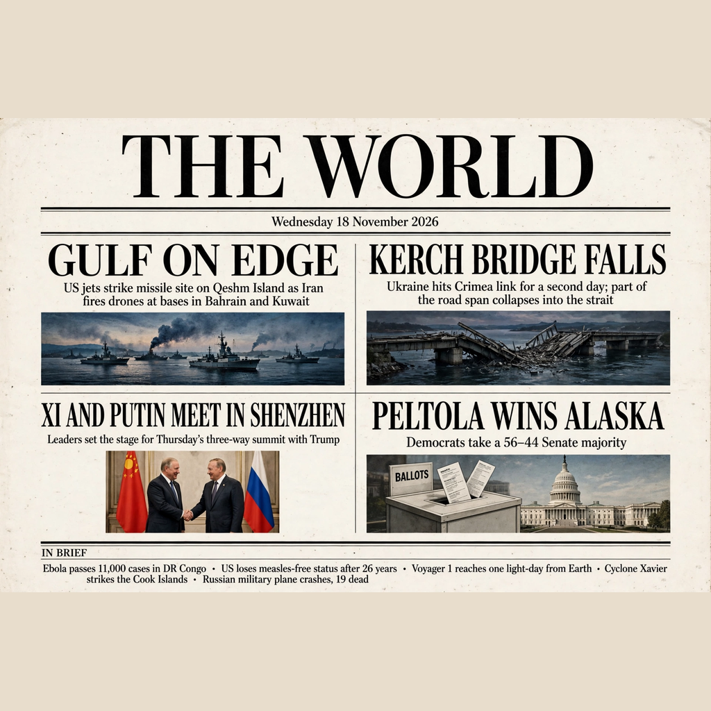

# THE WORLD — Wednesday 18 November 2026

A classic broadsheet front page summing up Wednesday 18 November 2026 in
one image: Gulf escalation as US jets strike a missile site on Qeshm Island
and Iran fires drones at bases in Bahrain and Kuwait; the Kerch Bridge to
Crimea hit for a second day; Xi Jinping and Vladimir Putin meeting in
Shenzhen ahead of Thursday's three-way summit with Donald Trump; and
Democrat Mary Peltola winning Alaska's Senate seat for a 56–44 Democratic
majority — plus an IN BRIEF strip with the day's Ebola, measles, Voyager 1,
Cyclone Xavier and Siberia plane-crash news.

`main.ts` (Node 22, stdlib only) copies `entry.png` to `/output/entry.png`.

SPDX-License-Identifier: MIT
